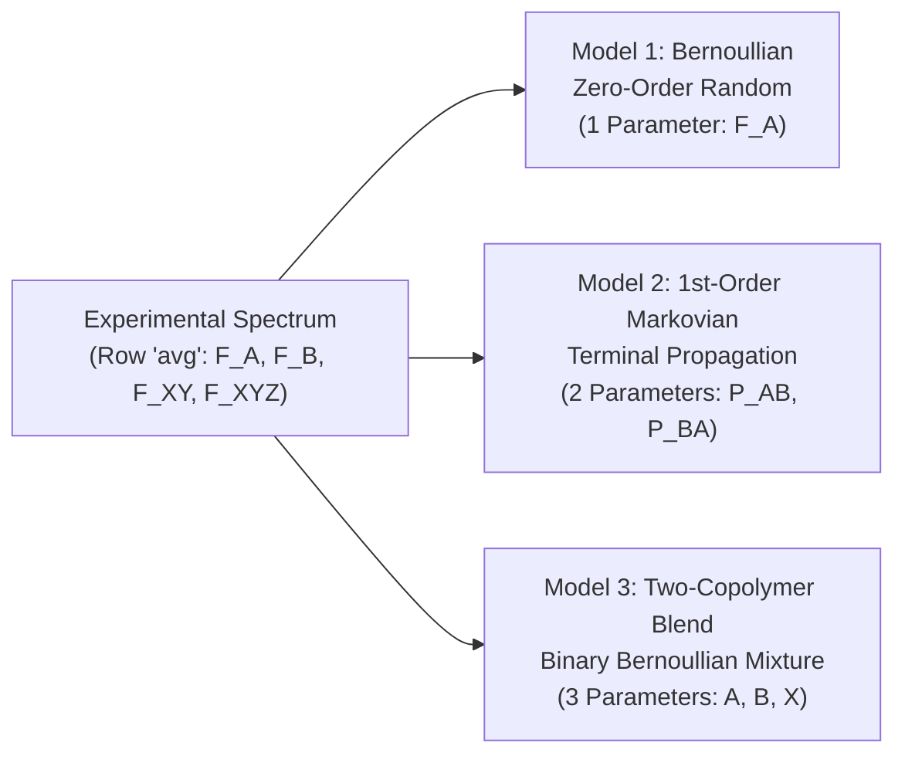

# Copolymer Microstructure & Statistical Models

This document details the theoretical and mathematical foundations of the copolymer microstructure calculations implemented in [`core/models.py`](../core/models.py). All formulas and models are derived from peer-reviewed literature on bacterial polyhydroxyalkanoates (PHAs) and chain copolymerization statistics.

---

## 1. Fundamental Sequence Notation & Probability Relations

Consider a binary copolymer composed of monomer units $A$ and $B$ (for example, $A = \text{3HV}$ and $B = \text{3HB}$ in PHBV, or $A = \text{4HB}$ and $B = \text{3HB}$ in P34HB).

### 1.1 Monad, Diad, and Triad Fractions
- **Monad Mole Fractions ($P_1$ or $F_X$)**:
  The unconditional probability (mole fraction) of finding monomer unit $A$ or $B$ in the polymer chain satisfies normalization:
  $$F_A + F_B = 1$$

- **Diad Mole Fractions ($P_2$ or $F_{XY}$)**:
  The fraction of adjacent monomer pairs $AA$, $AB$, $BA$, and $BB$ satisfies:
  $$F_{AA} + F_{AB} + F_{BA} + F_{BB} = 1$$
  By the **Principle of Microscopic Reversibility** for high-molecular-weight linear chains (ignoring end-group effects):
  $$F_{AB} = F_{BA}$$
  The successor/predecessor conservation relations connect monads and diads:
  $$F_A = F_{AA} + F_{AB} = F_{AA} + F_{BA}$$
  $$F_B = F_{BB} + F_{BA} = F_{BB} + F_{AB}$$

- **Triad Mole Fractions ($P_3$ or $F_{XYZ}$)**:
  For sequences of three consecutive monomer units centered on $A$ or $B$:
  $$F_{AA} = F_{AAA} + F_{AAB} = F_{AAA} + F_{BAA}$$
  $$F_{AB} = F_{ABA} + F_{ABB} = F_{AAB} + F_{BAB}$$
  $$F_{BA} = F_{BAA} + F_{BAB} = F_{ABA} + F_{BBA}$$
  $$F_{BB} = F_{BBA} + F_{BBB} = F_{ABB} + F_{BBB}$$
  By microscopic reversibility (mirror-image equivalence):
  $$F_{AAB} = F_{BAA}, \quad F_{ BBA} = F_{ABB}$$
  The sum over all eight triads equals unity:
  $$F_{AAA} + F_{ABA} + 2 F_{AAB} + 2 F_{BBA} + F_{BAB} + F_{BBB} = 1$$

### 1.2 Mapping to Code Keys (`keys_map`)
In [`core/config.py`](../core/config.py), each [`PolymerProfile`](../core/config.py#L214-L231) defines a `keys_map` dictionary translating abstract sequence notation ($A, B$) to the specific carbon/monomer labels of that polymer system:

| Abstract Key | PHBV (`B`, `V`) | P34HB (`B`, `F`) | PHBHHx (`B`, `X`) | Description |
| :--- | :---: | :---: | :---: | :--- |
| `A*` | `V*` | `F*` | `X*` | Minor/comonomer monad fraction $F_A$ |
| `B*` | `B*` | `B*` | `B*` | 3HB monad fraction $F_B$ |
| `AA` | `V*V` | `FF*` | `X*X` | Homo-diad $F_{AA}$ |
| `AB` | `V*B` | `FB*` | `X*B` | Cross-diad $F_{AB}$ |
| `BA` | `B*V` | `BF*` | `B*X` | Cross-diad $F_{BA}$ |
| `BB` | `B*B` | `BB*` | `B*B` | Homo-diad $F_{BB}$ |
| `AAA` | `VV*V` | `FF*F` | `XX*X` | $A$-centered homo-triad $F_{AAA}$ |
| `BAA` | `BV*V` | `BF*F` | `BX*X` | $A$-centered hetero-triad $F_{BAA}$ |
| `AAB` | `VV*B` | `FF*B` | `XX*B` | $A$-centered hetero-triad $F_{AAB}$ |
| `BAB` | `BV*B` | `BF*B` | `BX*B` | $A$-centered alternating triad $F_{BAB}$ |
| `BBB` | `BB*B` | `BB*B` | `BB*B` | $B$-centered homo-triad $F_{BBB}$ |
| `ABB` | `VB*B` | `FB*B` | `XB*B` | $B$-centered hetero-triad $F_{ABB}$ |
| `BBA` | `BB*V` | `BB*F` | `BB*X` | $B$-centered hetero-triad $F_{BBA}$ |
| `ABA` | `VB*V` | `FB*F` | `XB*X` | $B$-centered alternating triad $F_{ABA}$ |

---

## 2. Microstructural Metrics

### 2.1 Kamiya Randomness / Blockiness Parameter ($D$)
Introduced by Kamiya et al. (1989) [1] in Equation (2) to evaluate whether a bacterial copolyester obeys simple Bernoullian statistics:

$$D = \frac{F_{AA} \cdot F_{BB}}{F_{AB} \cdot F_{BA}}$$

- **Physical Interpretation**:
  - **$D = 1$**: Completely random (Bernoullian) copolymer. In practice, Kamiya et al. classify samples with $0.67 < D < 1.5$ as single random copolymers [1].
  - **$D > 1$**: "Blocky" microstructure—indicating either a true block copolymer or a physical blend (mixture) of random copolymers with different comonomer fractions ($D > 1.5$ typically exhibits multiple melting endotherms in DSC) [1, 3].
  - **$D < 1$**: Copolymer with an alternating tendency ($D \to 0$ for a strictly alternating $ABAB$ chain).
- **Equivalence to Reactivity Ratios**:
  Under first-order Markovian (terminal) copolymerization kinetics, $D$ is identically equal to the product of the monomer reactivity ratios [3]:
  $$D = r_A r_B = \frac{k_{AA}}{k_{AB}} \cdot \frac{k_{BB}}{k_{BA}} = \frac{P_{AA} P_{BB}}{P_{AB} P_{BA}}$$
- **Implementation**: [`calculate_d_parameter()`](../core/models.py#L12-L25). When cross-diad intensities $F_{AB}$ or $F_{BA}$ are zero (e.g., pure homopolymer blends or unpicked minor peaks), the function returns a sentinel value of `100.0` to prevent `ZeroDivisionError`.

### 2.2 Departure from Random Statistics ($\chi$)
Defined in Stanford ChemE 160/260 Lecture 7 [2] as the normalized cross-diad frequency relative to random expectation:

$$\chi = \frac{P_2\{BA\}}{P_1\{A\} \cdot P_1\{B\}} = \frac{F_{BA}}{F_A \cdot F_B}$$

- **Physical Interpretation**:
  - **$\chi = 1$**: Completely random copolymer ($F_{BA} = F_A F_B$).
  - **$\chi > 1$**: Copolymer with an alternating tendency.
  - **$\chi = 2$**: Strictly alternating copolymer (when $F_A = F_B = 0.5$ and $F_{BA} = 0.5$).
  - **$\chi < 1$**: Copolymer with a blocking tendency.
  - **$\chi = 0$**: Complete block copolymer or homopolymer blend ($F_{BA} \to 0$).
- **Implementation**: [`calculate_chi_parameter()`](../core/models.py#L27-L40). Returns `NaN` if either monomer fraction $F_A$ or $F_B$ is zero.

### 2.3 Number-Average Sequence Lengths ($\bar{l}_A, \bar{l}_B$)
The number-average run length (block length) $\bar{l}_A$ of contiguous $A$ units bounded by $B$ units ($-B A_n B-$) is derived from the number distribution function $N_A(n) = \frac{P_{n+2}\{B A_n B\}}{P_2\{AB\}}$ [2]:

$$\bar{l}_A = \frac{\sum_{n=1}^{\infty} n N_A(n)}{\sum_{n=1}^{\infty} N_A(n)} = \frac{\sum_{n=1}^{\infty} n P_{n+2}\{B A_n B\}}{P_2\{AB\}} = \frac{P_1\{A\}}{P_2\{AB\}} = \frac{F_A}{F_{AB}}$$

Similarly, for monomer $B$:

$$\bar{l}_B = \frac{P_1\{B\}}{P_2\{BA\}} = \frac{F_B}{F_{BA}}$$

- **For a Bernoullian random copolymer**: $\bar{l}_A = \frac{1}{1 - F_A} = \frac{1}{F_B}$ and $\bar{l}_B = \frac{1}{F_A}$.
- **Implementation**: [`calculate_average_lengths()`](../core/models.py#L42-L61), exported as `len_V` / `len_F` / `len_X` and `len_B` in the CSV report.

---

## 3. Statistical Reaction Models

`PHACS-NMR` evaluates three theoretical sequence distribution models against the experimentally averaged diad and triad proportions (row `'avg'`) to diagnose polymerization mechanisms and blend behavior [1, 3].

### 3.1 Model 1: Bernoullian Random Copolymer (`model_1`)
In a zero-order Markovian (Bernoullian) process, the probability of adding monomer $A$ or $B$ to the growing chain end is independent of the identity of the terminal unit [1, 2]. Using the experimentally measured monad fractions $F_A^E$ and $F_B^E$ (Kamiya Eq. 1 & 3):

- **Diad Distribution**:
  $$F_{AA} = (F_A^E)^2$$
  $$F_{AB} = F_{BA} = F_A^E F_B^E$$
  $$F_{BB} = (F_B^E)^2$$

- **$A$-Centered Triad Distribution**:
  $$F_{AAA} = (F_A^E)^3$$
  $$F_{BAA} = F_{AAB} = (F_A^E)^2 F_B^E$$
  $$F_{BAB} = F_A^E (F_B^E)^2$$

- **$B$-Centered Triad Distribution**:
  $$F_{BBB} = (F_B^E)^3$$
  $$F_{ABB} = F_{BBA} = F_A^E (F_B^E)^2$$
  $$F_{ABA} = (F_A^E)^2 F_B^E$$

- **Implementation**: [`compute_kamiya_model_1()`](../core/models.py#L64-L90). Note that Model 1 always yields $D = 1.0$ and $\chi = 1.0$.

### 3.2 Model 2: First-Order Markovian Model (`model_2`)
In the first-order Markovian (terminal) model, monomer addition depends on the ultimate unit at the propagating chain end [1, 2, 3]. The conditional transition probabilities $P_{ij}$ (probability that unit $j$ follows unit $i$) are estimated from experimental monad and diad fractions (Kamiya Eq. 4):

$$P_{AA} = \frac{F_{AA}^E}{F_A^E}, \quad P_{AB} = \frac{F_{AB}^E}{F_A^E}, \quad P_{BA} = \frac{F_{BA}^E}{F_B^E}, \quad P_{BB} = \frac{F_{BB}^E}{F_B^E}$$

From steady-state conservation ($F_A P_{AB} = F_B P_{BA}$), the theoretical sequence distributions are reconstructed purely from the conditional probabilities (Kamiya Eq. 5):

- **Diad Distribution**:
  $$F_{AA} = \frac{P_{AA} P_{BA}}{P_{AB} + P_{BA}}, \quad F_{AB} = F_{BA} = \frac{P_{AB} P_{BA}}{P_{AB} + P_{BA}}, \quad F_{BB} = \frac{P_{AB} P_{BB}}{P_{AB} + P_{BA}}$$

- **$A$-Centered Triad Distribution**:
  $$F_{AAA} = \frac{P_{AA}^2 P_{BA}}{P_{AB} + P_{BA}}, \quad F_{BAA} = F_{AAB} = \frac{P_{AA} P_{AB} P_{BA}}{P_{AB} + P_{BA}}, \quad F_{BAB} = \frac{P_{AB}^2 P_{BA}}{P_{AB} + P_{BA}}$$

- **$B$-Centered Triad Distribution**:
  $$F_{BBB} = \frac{P_{BB}^2 P_{AB}}{P_{AB} + P_{BA}}, \quad F_{ABB} = F_{BBA} = \frac{P_{BB} P_{BA} P_{AB}}{P_{AB} + P_{BA}}, \quad F_{ABA} = \frac{P_{BA}^2 P_{AB}}{P_{AB} + P_{BA}}$$

- **Implementation**: [`compute_kamiya_model_2()`](../core/models.py#L93-L133). Includes a $10^{-12}$ floor on $P_{AB} + P_{BA}$ to prevent zero-division on pure homopolymers.

### 3.3 Model 3: Two-Component Bernoullian Blend (`model_3`)
Biosynthesis under fluctuating carbon substrate concentrations or pulse feeding frequently produces a physical mixture (blend) of random copolymers with distinct comonomer compositions rather than a true block copolymer [1, 3]. Model 3 represents the sample as a binary blend of two Bernoullian random copolymers:
- **Component 1**: Bernoullian copolymer with $A$-monomer mole fraction $a \in [0, 1]$, present at molar fraction $X \in [0, 1]$.
- **Component 2**: Bernoullian copolymer with $A$-monomer mole fraction $b \in [0, 1]$, present at molar fraction $(1 - X)$.

The parameters $(a, b, X)$ are determined from the experimental $A$-centered triad fractions by solving the system of three non-linear equations (Kamiya Eq. 6):

$$\begin{cases}
f_0(a, b, X) = a^3 X + b^3 (1 - X) - F_{AAA}^E = 0 \\[6pt]
f_1(a, b, X) = a^2 (1 - a) X + b^2 (1 - b) (1 - X) - \dfrac{F_{BAA}^E + F_{AAB}^E}{2} = 0 \\[6pt]
f_2(a, b, X) = a (1 - a)^2 X + b (1 - b)^2 (1 - X) - F_{BAB}^E = 0
\end{cases}$$

Once solved via `scipy.optimize.fsolve` starting from initial guess $z_0 = [0, 0, 0]$, all monad, diad, and triad fractions are reconstructed (Kamiya Eq. 7):

$$F_A = a X + b (1 - X), \quad F_B = (1 - a) X + (1 - b) (1 - X)$$
$$F_{AA} = a^2 X + b^2 (1 - X), \quad F_{AB} = F_{BA} = a(1 - a) X + b(1 - b)(1 - X)$$
$$F_{BB} = (1 - a)^2 X + (1 - b)^2 (1 - X)$$
$$F_{BBB} = (1 - a)^3 X + (1 - b)^3 (1 - X)$$
$$F_{ABB} = F_{BBA} = a(1 - a)^2 X + b(1 - b)^2 (1 - X)$$
$$F_{ABA} = a^2(1 - a) X + b^2(1 - b) (1 - X)$$

- **Convergence Criterion**: Physically valid two-component blends require $0 < a, b, X < 1$. When a sample is already a single homogeneous random copolymer ($D \approx 1$), the Jacobian becomes singular and `fsolve` may emit a `RuntimeWarning` or converge outside $[0, 1]$, which corresponds to annotation `b` ("Not converged in $0 < A, B, X < 1$") in Kamiya Table IV [1].
- **Implementation**: [`compute_kamiya_model_3()`](../core/models.py#L136-L182).

### 3.4 Relationship to Two-State Polyester Models (Suganuma et al. 2019)
While Kamiya's Model 3 models a **spatial mixture** of two independent Bernoullian chains ($X$ and $1-X$), Suganuma et al. (2019) [5] formulated an analogous **two-state Bernoullian model** for ring-opening polymerization of polyesters (such as PLA) subject to transesterification and racemization. In Suganuma's formulation, sequence intensities are modeled as a weighted sum $f_1 I_{\text{SAB}} + f_2 I_{\text{PAB}}$ ($f_1 + f_2 = 1$) of single-addition Bernoullian (SAB) and pair-addition Bernoullian (PAB) propagation states. Both approaches share the same underlying mathematical principle: decomposing non-Bernoullian polyester NMR multiplets into linear combinations of elementary Bernoullian basis distributions.

---

## 4. Quantitative $^{13}\text{C}$ Processing & Homologous Normalization

The statistical models in `PHACS-NMR` treat fitted relative peak areas as direct molar sequence fractions ($I_{XYZ} \propto F_{XYZ}$):

- **Quantitative Spectrometer Acquisition**: Quantitative acquisition requirements (suppression of NOE via inverse-gated decoupling `zgig30` and long recycle delays $D_1 \ge 8\text{ s}$ to prevent signal saturation) are specified in **[Software Protocol v2.pdf](../Software%20Protocol%20v2.pdf)** [6] (see also [1, 3, 4]).
- **Homologous Carbon Normalization (`core/engine.py`)**: As an implementation safeguard against residual differential $T_1$ relaxation across different functional groups ($C_1$ vs. $C_2$ vs. $C_3$ vs. $C_4$), `PHACS-NMR` calculates monad and diad ratios strictly **within homologous carbon pairs** sharing equivalent chemical environments (Row 1: $C_1/C_1$, Row 2: $C_2/C_2$, Row 3: $C_3/C_3$, Row 4: $C_4/C_4$). These independent measurements are then averaged into the consensus `'avg'` row in [`core/engine.py`](../core/engine.py).

---

## 5. References

1. **Kamiya, N.; Yamamoto, Y.; Inoue, Y.; Chûjô, R.; Doi, Y.** Microstructure of Bacterially Synthesized Poly(3-hydroxybutyrate-co-3-hydroxyvalerate). *Macromolecules* **1989**, *22* (4), 1676–1682. DOI: `10.1021/ma00194a030` (`Papers/Kamiya-1989.pdf`).
2. **Frank, C. W.** *Lecture 7: Statistics of Chain Copolymerization*; Chemical Engineering 160/260 (Polymer Science and Engineering), Stanford University, January 31, **2001** (`Papers/lecture7.pdf`).
3. **Ivanova, G.; Serafim, L. S.; Lemos, P. C.; Ramos, A. M.; Reis, M. A. M.; Cabrita, E. J.** Influence of feeding strategies of mixed microbial cultures on the chemical composition and microstructure of copolyesters P(3HB-co-3HV) analyzed by NMR and statistical analysis. *Magn. Reson. Chem.* **2009**, *47* (6), 497–504. DOI: `10.1002/mrc.2423` (`Papers/Ivanova-2009.pdf`).
4. **Shapiro, Yu. E.** Analysis of Chain Microstructure by $^1\text{H}$ and $^{13}\text{C}$ NMR Spectroscopy. *Bull. Magn. Reson.* **1985**, *7* (1), 27–58 (`Papers/Shapiro.pdf`).
5. **Suganuma, K.; Asakura, T.; Oshimura, M.; Hirano, T.; Ute, K.; Cheng, H. N.** NMR Analysis of Poly(Lactic Acid) via Statistical Models. *Polymers* **2019**, *11* (4), 725. DOI: `10.3390/polym11040725` (`Papers/Suganuma_etal_2019_polymers-11-00725.pdf`).
6. **Fornes, C.** *Protocol for using PHA software: $^1\text{H}$ NMR characterization of monomer composition and $^{13}\text{C}$ NMR characterization of copolymer microstructure*; Technical Protocol v2, December **2025** (`Software Protocol v2.pdf`).
7. **Virtanen, P.; Gommers, R.; Oliphant, T. E.; Haberland, M.; Reddy, T.; Cournapeau, D.; et al. (SciPy 1.0 Contributors).** SciPy 1.0: Fundamental Algorithms for Scientific Computing in Python. *Nat. Methods* **2020**, *17* (3), 261–272. DOI: `10.1038/s41592-019-0686-2` (Applied in Model 3 non-linear equation system solving via `scipy.optimize.fsolve`).
8. **Harris, C. R.; Millman, K. J.; van der Walt, S. J.; Gommers, R.; Virtanen, P.; et al.** Array programming with NumPy. *Nature* **2020**, *585*, 357–362. DOI: `10.1038/s41586-020-2649-2`.
